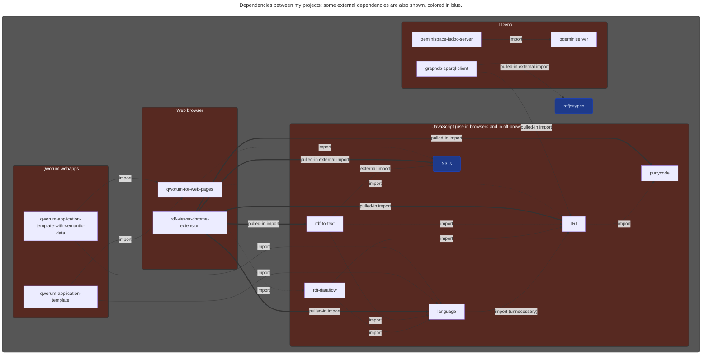

Although I do a fair amount of closed source work, many of my projects are public-access on GitHub and on [JSR](https://jsr.io/user/9d201edf-5d16-4f36-b5a7-28add71c9e5f).

## Qworum

[Qworum](https://qworum.net) is a new variant of the World Wide Web that is especially suitable for applications. This is in contrast to the current Web that is still fundamentally a content platform, even if nowadays Web pages have significant amounts of JavaScript sprinkled on them.

Qworum is a commercial PaaS/iPaaS hybrid offering that is based on the first API technology to support interactive processes, which in turn is based on a [software patent](https://patents.google.com/patent/US8266632).

[qworum-for-web-pages](https://github.com/doga/qworum-for-web-pages)

## Some of my notable projects

## What I am working with

